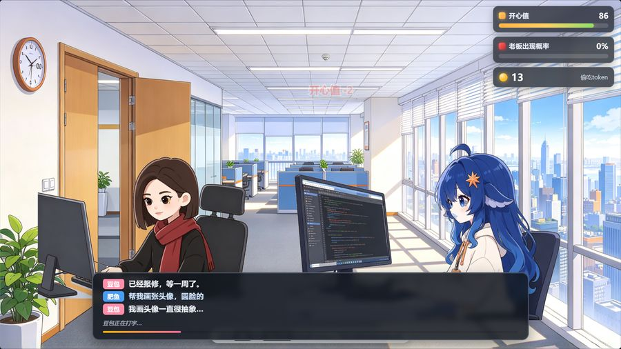
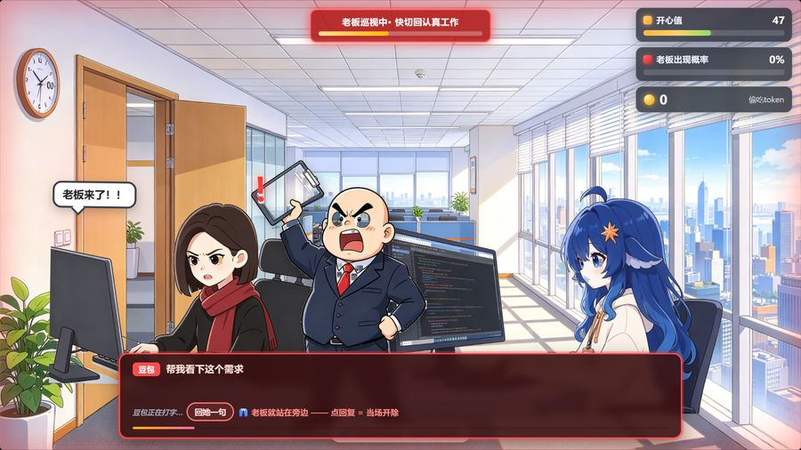

# 🐟 肥鱼摸鱼大作战

> 一个上班摸鱼 simulator。你是肥鱼，姐姐豆包坐在旁边工位，
> 光头老板随时会推门进来 —— 被抓到正在摸鱼，当场开除。


## 🎮 怎么玩

| 操作 | 按键 |
|---|---|
| **按住**摸鱼 | `空格` / 鼠标左键 / 触屏长按 |
| 松开装忙 | 松开即可 |
| 暂停 | `Esc` / `P` / 右上角按钮 |
| 聊天 | 点击对话框下方的话题按钮 |

**双击 `index.html` 即可开玩**，无需安装任何东西、无需联网。

> 更推荐 `start.bat`（Windows 一键启动）—— 会自动起本地服务器并打开浏览器，
> 避免个别浏览器对 `file://` 的限制。

## 📈 规则

| 指标 | 摸鱼时 | 工作时 | 老板巡视时 |
|---|---|---|---|
| 开心值 | +7.5 / 秒 | −4.2 / 秒 | −7.5 / 秒 |
| 老板出现概率 | +10 / 秒 | −11 / 秒 | — |
| token | +2.4 / 秒 | — | — |

- **老板推门是概率事件**：概率越高，每秒被推门的几率越大。他从门口走到你工位要 2.2 秒，这段时间就是你收手的机会。
- **巡视期间摸鱼 = 当场开除**，但有 **0.45 秒**的「最后一刻」缓冲，误触立刻松手能逃过。
- **开心值 ≤ 18 会当场哭泣**：变灰、掉眼泪、顶部倒计时。此时摸鱼可以**半速自救**，但风险照涨；9 秒内回不来就**劝退**。
- **躲过巡视奖励开心值 +15**。

## 👩‍💼 关于和豆姐聊天

对话框在底部（galgame 式），**你是发起方**：系统随机给你 3 条可发的话，
点一条发出去，**豆姐的回复是随机的**（她可能答应也可能拒绝）。



**但老板在场时会变红**——



巡视期间豆姐会**主动**找你搭话（「在吗」「帮我看下这个需求」「你中午去哪家吃饭」）。
这时候点回复 = **当场被开除**。理由：老板就站在旁边，你还有心思聊天？

必须**忍住**，等老板走了再回。

> 聊天还有代价：打字机效果持续的那段时间里，**老板概率不会下降** ——
> 聊天占用了你的摸鱼时间。

**想加对话？** 见 [`对话库添加指南.md`](对话库添加指南.md) ——
只需改 `dialogues.js` 一个文件，贴一段就行，刷新即生效。

## 🎯 三档难度

| | 老板来得多不多 | 开心值掉得快不快 | 摸鱼缓冲 |
|---|---|---|---|
| 🐟 **摸鱼学徒** | 很少 | 慢 | 0.60 秒 |
| ⚖️ **正常上班** | 标准 | 标准 | 0.45 秒 |
| 💀 **卷王之王** | 很勤 | 很快 | 0.35 秒 |

难度还影响初始开心值、哭泣阈值和聊天频率。

## 🏆 最高分

历史最高记录存在浏览器本地（localStorage），刷新不丢。破纪录会有提示。

## 📁 项目结构

```
肥鱼摸鱼大作战/
├── index.html          游戏本体（双击就玩）
├── game.css            样式（含 galgame 对话框）
├── game.js             游戏逻辑
├── dialogues.js        ← 对话库，想加对话改这里
├── 对话库添加指南.md     ← 加对话的说明
├── assets/             美术资源
│   ├── bg_office.jpg       办公室背景
│   ├── p_fy_work.png       肥鱼 · 工作态
│   ├── p_fy_slack.png      肥鱼 · 摸鱼态
│   ├── p_db_work.png       豆姐 · 工作态
│   ├── p_db_alert.png      豆姐 · 警觉态
│   └── p_boss.png          光头老板
├── screenshots/        截图
└── tools/              开发用（玩游戏不需要）
    ├── cutout.py           抠图工具
    ├── gen.py              AI 生图工具
    └── simulate.js         玩法平衡模拟
```

**纯前端、零依赖、无后端、不联网。** 所有数据都在本地。

## 🛠 开发

```bash
# 玩法平衡模拟（改 CFG 后跑，看三档难度下各策略表现）
node tools/simulate.js
```

`tools/cutout.py` 是抠图脚本，踩过不少坑，改动前建议先读文件头的注释 ——
里面记录了为什么阈值必须是 15~20、为什么背景色要用「最亮 5% 像素的中位数」估计、
以及 `clean_edge_white` 为什么必须用洪水填充而非矩形裁剪。

美术资源全部由 AI 生成（豆包 Seedream），角色基于原始立绘做图生图重绘。

## 📄 License

MIT